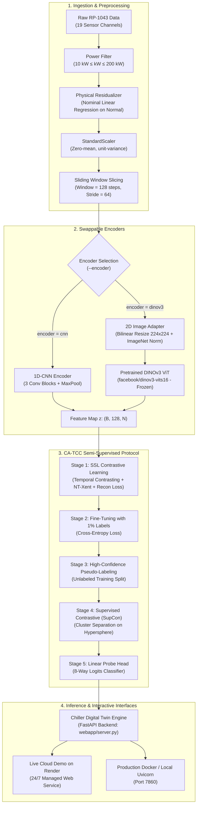

# Chiller Fault Detection & Severity Assessment Platform (FDD)

> **Industrial Chiller Fault Detection and Diagnosis (FDD) & Digital Twin Platform powered by Contextualized Contrastive Semi-Supervised Learning (CA-TCC / TS-TCC), featuring 1D-CNN and Meta AI Pretrained Vision Transformer (DINOv3) Encoders on the ASHRAE RP-1043 Benchmark.**

---

## Table of Contents
1. [Project Overview](#1-project-overview)
   - [What the Project Does](#11-what-the-project-does)
   - [Problems Solved](#12-problems-solved)
   - [Target Audience](#13-target-audience)
2. [System Architecture & Environment](#2-system-architecture--environment)
   - [End-to-End System Pipeline](#21-end-to-end-system-pipeline)
   - [Runtime & Environment Specifications](#22-runtime--environment-specifications)
3. [AI Model Specification](#3-ai-model-specification)
   - [Task Definition & 8-Way Fault Classes](#31-task-definition--8-way-fault-classes)
   - [Input Data Specification & 19 Sensor Channels](#32-input-data-specification--19-sensor-channels)
   - [Physics-Informed Residualization](#33-physics-informed-residualization)
   - [Output Specification](#34-output-specification)
   - [1D-CNN Encoder Architecture (`base_Model`)](#35-1d-cnn-encoder-architecture-base_model)
4. [DINOv3 Foundation Model Integration](#4-dinov3-foundation-model-integration)
   - [Architecture & Encoder Contract Swap](#41-architecture--encoder-contract-swap)
   - [Input Adaptation (Sensor Window to 2D Image Plane)](#42-input-adaptation-sensor-window-to-2d-image-plane)
   - [Strong-View 2D Patch Masking vs 1D Permutation](#43-strong-view-2d-patch-masking-vs-1d-permutation)
   - [Hugging Face Checkpoints & Model Variants](#44-hugging-face-checkpoints--model-variants)
   - [Code Changes & Design Rationale](#45-code-changes--design-rationale)
   - [Status & Limitations](#46-status--limitations)
5. [Loss Functions & Parameter Updates](#5-loss-functions--parameter-updates)
   - [Stage 1: Self-Supervised Contrastive & Reconstruction Loss](#51-stage-1-self-supervised-contrastive--reconstruction-loss)
   - [Stage 2: Supervised Fine-Tuning Loss (1% Labels)](#52-stage-2-supervised-fine-tuning-loss-1-labels)
   - [Stage 3: Pseudo-Labeling](#53-stage-3-pseudo-labeling)
   - [Stage 4: Supervised Contrastive Loss (SupCon)](#54-stage-4-supervised-contrastive-loss-supcon)
   - [Stage 5: Linear Probe Head](#55-stage-5-linear-probe-head)
   - [Stage-by-Stage Gradient Updates Matrix](#56-stage-by-stage-gradient-updates-matrix)
6. [Directory Structure & Configuration Files](#6-directory-structure--configuration-files)
   - [Project Directory Tree](#61-project-directory-tree)
   - [Configuration Files Reference](#62-configuration-files-reference)
   - [Model Checkpoint Registry](#63-model-checkpoint-registry)
7. [Step-by-Step Installation & Execution Guide](#7-step-by-step-installation--execution-guide)
   - [Step 1: Environment Setup](#step-1-environment-setup)
   - [Step 2: Data Pipeline (Load & Preprocess RP-1043)](#step-2-data-pipeline-load--preprocess-rp-1043)
   - [Step 3: Training Models (CNN & DINOv3)](#step-3-training-models-cnn--dinov3)
   - [Step 4: Running Interactive Demos](#step-4-running-interactive-demos)
8. [Troubleshooting & Common Errors](#8-troubleshooting--common-errors)
9. [References](#9-references)

---

## 1. Project Overview

### 1.1. What the Project Does
This repository delivers an end-to-end industrial **Fault Detection and Diagnosis (FDD)** and **Digital Twin Simulation** platform for water-cooled centrifugal chiller systems based on the benchmark **ASHRAE RP-1043** dataset. 

Key capabilities:
- Ingests multivariate sensor streams (temperatures, pressures, power consumption, superheat, subcooling).
- Normalizes thermal dynamics against operating loads via **Physics-Informed Residualization**.
- Detects and classifies **8 operational states** (1 normal baseline and 7 typical chiller fault types).
- Evaluates real-time health scores, tracks anomalous time segments, and provides an interactive **Digital Twin Webapp** with physical slider fault injection.
- Seamlessly switches between a lightweight **1D-CNN** time-series encoder and a **pretrained Meta DINOv3 Vision Transformer (ViT)** encoder via contrastive learning (**CA-TCC / TS-TCC**).

### 1.2. Problems Solved
1. **Critical Energy Waste**: Chillers account for **40% to 60%** of total HVAC electrical consumption in commercial high-rises, hospitals, manufacturing facilities, and data centers.
2. **Incipient Fault Degradation**: Degradation faults (such as condenser fouling, refrigerant undercharge, or non-condensable gas) develop gradually, dropping the Coefficient of Performance (COP) by 10%–30% without triggering emergency shutdown alarms. This wastes tens of thousands of dollars in excess utility costs and accelerates catastrophic compressor failure.
3. **Severe Label Scarcity**: In real-world building management systems (BMS), unlabeled operational telemetry is abundant, whereas rigorously labeled fault instances are exceedingly rare (< 1%–5%). Standard supervised learning overfits and fails. This platform resolves label scarcity through **Self-Supervised & Semi-Supervised Contrastive Learning (CA-TCC)**, extracting robust temporal representations with as little as **1% labeled data**.

### 1.3. Target Audience
- **HVAC Operations & Maintenance Engineers**: Continuous health monitoring, early-stage fault isolation, and actionable diagnostics.
- **Facility & Energy Managers**: Predictive maintenance scheduling, OPEX reduction, and chiller plant efficiency optimization.
- **AI & Industrial IoT Researchers**: A state-of-the-art benchmark platform for exploring Time-Series Foundation Models, Vision Transformers for multivariate telemetry, and physics-guided semi-supervised learning.

---

## 2. System Architecture & Environment

### 2.1. End-to-End System Pipeline



### 2.2. Runtime & Environment Specifications

| Environment Component | Minimum Requirement | Recommended for Training |
| :--- | :--- | :--- |
| **Operating System** | Linux (Ubuntu 20.04/22.04), macOS, Windows WSL2 | Ubuntu 22.04 LTS x86_64 |
| **Python Version** | `Python >= 3.13` (or `3.12` via Dockerfile) | `Python 3.13` managed via `uv` |
| **Package Manager** | [Astral uv](https://docs.astral.sh/uv/) `>= 0.4.0` | `uv` with lockfile verification |
| **Processor (CPU)** | 4-Core x86_64 / Apple Silicon (for demo & inference) | 8+ Core modern CPU |
| **Memory (RAM)** | 8 GB System Memory | 16 GB – 32 GB System Memory |
| **GPU Acceleration** | None (CPU inference supported for demo) | NVIDIA GPU $\ge$ 8GB VRAM (Compute Capability $\ge$ 7.5: RTX 2080, 3090, 4090, A100) |
| **Deep Learning Stack** | PyTorch $\ge$ 2.14, Transformers $\ge$ 4.56 | PyTorch with CUDA 12.x |

---

## 3. AI Model Specification

### 3.1. Task Definition & 8-Way Fault Classes
The model performs **8-class multivariate time-series fault classification** on chiller sensor telemetry.

| Class Name | Fault ID | Full Name | Physical Symptoms & Characteristics |
| :---: | :---: | :--- | :--- |
| `normal` | 0 | Normal Baseline | All thermodynamic parameters operate in balanced steady-state. |
| `cf` | 1 | Condenser Fouling | Scale buildup on condenser water tubes; condenser approach temperature (`TCA`) rises. |
| `fwe` | 2 | Reduced Evaporator Flow | Chilled water flow reduction; evaporator water temp difference (`CHW_DT`) widens; freeze risk. |
| `fwc` | 3 | Reduced Condenser Flow | Cooling water flow reduction; condenser temp difference (`CDW_DT`) and pressure (`PRC`) climb. |
| `ro` | 4 | Refrigerant Overcharge | Excess refrigerant charge; liquid subcooling (`TRC_sub`) and condensing pressure (`PRC`) surge. |
| `rl` | 5 | Refrigerant Leak / Undercharge | Refrigerant loss; suction superheat (`Tsh_suc`) rises; subcooling (`TRC_sub`) drops sharply. |
| `nc` | 6 | Non-condensable Gas | Air ingress in condenser; condensing pressure (`PRC`) jumps far above saturated pressure. |
| `eo` | 7 | Excess Oil | Oil overcharge; lubricating oil films impair heat transfer; net oil pressure (`PO_net`) fluctuates. |

### 3.2. Input Data Specification & 19 Sensor Channels
- **Input Tensor Layout**: `(B, C, T) = (Batch_Size, 19 Channels, 128 Timesteps)`.
- **Sampling Frequency**: $dt = 10\text{ seconds}$ per timestamp. A window of 128 steps corresponds to **21.3 minutes** of continuous machine operation.
- **19 Sensor Channels**:
  - *Temperatures (°F)*: `TEI` (evaporator entering water), `TEO` (evaporator leaving water), `TCI` (condenser entering water), `TCO` (condenser leaving water), `TRE` (evaporator refrigerant temp), `TRC` (condenser refrigerant temp), `TRC_sub` (liquid subcooling), `T_suc` (suction temp), `Tsh_suc` (suction superheat), `TR_dis` (discharge temp), `Tsh_dis` (discharge superheat), `TEA` (evaporator approach), `TCA` (condenser approach), `TO_sump` (oil sump temp).
  - *Pressures (psig / psi)*: `PRE` (evaporator pressure), `PRC` (condenser pressure), `P_lift` (pressure lift), `PO_net` (net oil pressure), `PO_feed` (feed oil pressure).
  - *Derived & Operating Knobs*: `kW` (compressor power), `CDW_DT` ($TCO - TCI$), `CHW_DT` ($TEI - TEO$).

### 3.3. Physics-Informed Residualization
Chiller measurements vary dramatically across different cooling loads and ambient conditions. Passing raw values directly leads models to confuse normal load variations with genuine equipment faults.
- A **Linear Regression** model is fitted strictly on `normal` baseline operation against 3 operational boundary conditions:

$$
\hat{X}_{\text{nominal}} = f(\text{TEO}, \text{TCI}, \text{kW})
$$

- The input to the neural encoder is the **physical residual**:

$$
\Delta X = X_{\text{measured}} - \hat{X}_{\text{nominal}}
$$
- 17 residual channels are combined with 2 raw pressure channels (`PO_net`, `PO_feed`) and passed through `StandardScaler` to ensure zero mean and unit variance.

### 3.4. Output Specification
1. **8-Way Class Probabilities**: Softmax probabilities $P(y = c \mid X) \in [0, 1]^8$.
2. **Feature Embeddings**: Intermediate representation vector $(B, 128, N)$ for latent space clustering and t-SNE analysis.
3. **Temporal Segments**: Consecutive windows sharing identical predicted labels are merged into continuous diagnostic intervals defined by start time ($t_0$), end time ($t_1$), duration (seconds), and mean confidence.
4. **Health Ratio**: Percentage of operational duration diagnosed as `normal` over the monitored period.

### 3.5. 1D-CNN Encoder Architecture (`base_Model`)
Defined in [`src/chiller_fault_detection/models/model.py`](src/chiller_fault_detection/models/model.py):
- **ConvBlock 1**: `Conv1d(19, 32, kernel=8, padding=4)` $\to$ `BatchNorm1d` $\to$ `ReLU` $\to$ `MaxPool1d(2)` $\to$ `Dropout(0.35)`.
- **ConvBlock 2**: `Conv1d(32, 64, kernel=8, padding=4)` $\to$ `BatchNorm1d` $\to$ `ReLU` $\to$ `MaxPool1d(2)`.
- **ConvBlock 3**: `Conv1d(64, 128, kernel=8, padding=4)` $\to$ `BatchNorm1d` $\to$ `ReLU` $\to$ `MaxPool1d(2)`.
- **Temporal Reduction**: Maps $T = 128$ to length $L = 18$.
- **Linear Head**: `Linear(18 * 128, 8)`.

---

## 4. DINOv3 Foundation Model Integration

This section documents the integration of Meta AI's pretrained **DINOv3 Vision Transformer (ViT)** as a swappable encoder alongside the original 1D-CNN.

### 4.1. Architecture & Encoder Contract Swap

```text
Original 1D-CNN (base_Model):
Windows (B, C=19, T=128) → 3 Conv Blocks → Features (B, 128, 18)
                         → Linear Logits Head (B, 8)
                         → Temporal Contrasting (TC) reads features

DINOv3 ViT Encoder (Dinov3Encoder):
Windows (B, C=19, T=128) → 2D Image Adapter → DINOv3 ViT → 1x1 Conv Projection
                         → Features (B, 128, N)
                         → Linear Logits Head (B, 8)
                         → Temporal Contrasting (TC) reads features
```

`N = (img_size / patch_size)²`. The default `224 / 16` grid is 14×14, so `N = 196`. CNN length 18 is the temporal size after three conv/pool blocks on `T = 128`.

| Component | 1D-CNN (`base_Model`) | DINOv3 ViT (`Dinov3Encoder`) |
| :--- | :--- | :--- |
| **Backbone** | Three 1D conv blocks, trained from scratch | Meta DINOv3 ViT, loaded from Hugging Face Hub |
| **Backbone Gradients** | Updated throughout all stages | **Frozen** in `eval()` + `torch.no_grad()` (unless `--finetune-encoder`) |
| **Projection Layer** | None (3rd conv block outputs 128 channels) | Trainable `Conv1d(384, 128, 1)` + `BatchNorm1d` + `GELU` |
| **Classification Head** | `Linear(18 * 128, 8)` | Same contract: `Linear(N * 128, 8)` |
| **Temporal Contrasting (TC)** | Original module, trainable | Same module, trainable |
| **Loss Formulations** | Standard TS-TCC / CA-TCC losses | Adapted temperature (0.07) + Masked Feature Reconstruction ($L_{\text{recon}}$) |
| **Feature Contract** | `(B, 128, 18)` (Length $18 > \text{timesteps}$) | `(B, 128, N)` ($N > \text{timesteps}$) |

Freezing ensures that DINOv3 weights are never corrupted by small-batch telemetry noise. `build_encoder` calls `freeze_backbone()`. Even when `Trainer` sets `model.train()`, the ViT backbone remains pinned in `eval()` mode so that DropPath does not randomly perturb features.

### 4.2. Input Adaptation (Sensor Window to 2D Image Plane)
DINOv3 expects an ImageNet-normalized 3-channel RGB image. The telemetry window is transformed in `Dinov3Encoder._windows_to_images` via a 7-step deterministic procedure:

- **Step 1: Independent Window Min-Max Scaling**  
  Scale each window independently to $[0, 1]$:

  $$
  \tilde{X} = \frac{X - \min(X)}{\max(X) - \min(X) + \epsilon}
  $$

- **Step 2: Channel-as-Height, Time-as-Width**  
  Treat sensor channels as image height and time as image width, yielding shape `(B, 1, C=19, T=128)`.

- **Step 3: Bilinear Interpolation**  
  Interpolate bilinearly to a square grid `(img_size, img_size)` (default $224 \times 224$).

- **Step 4: Channel Duplication**  
  Replicate the single grayscale plane across 3 RGB channels `(B, 3, 224, 224)`.

- **Step 5: ImageNet Normalization**  
  Subtract ImageNet mean `(0.485, 0.456, 0.406)` and divide by standard deviation `(0.229, 0.224, 0.225)`.

- **Step 6: ViT Patch Extraction**  
  Forward pass through DINOv3. Discard the CLS token and register tokens; extract the $N = 196$ patch tokens of width 384 (for `vits16`).

- **Step 7: Projection & Logits**  
  Project hidden width $384 \to 128$ via $1 \times 1$ convolution. Flatten into `(B, 8)` for the logits head.

### 4.3. Strong-View 2D Patch Masking vs 1D Permutation
- **Weak View (Both Encoders)**: Mild Gaussian jitter followed by scaling.
- **CNN Strong View**: Permutes 1D temporal segments and applies high-magnitude jitter ($\sigma = 0.8$).
- **DINOv3 Strong View**: DINOv3 adds fixed 2D positional embeddings to every patch. Permuting time segments causes synthetic discontinuities that clash with 2D spatial priors. Therefore, the DINOv3 strong view uses mild jitter ($\sigma = 0.2$) followed by **2D Patch Masking** (`apply_patch_mask`), zeroing out $\approx 40\%$ of the $16 \times 16$ spatial patches directly on the image plane.

### 4.4. Hugging Face Checkpoints & Model Variants
The default backbone is Meta’s [`facebook/dinov3-vits16-pretrain-lvd1689m`](https://huggingface.co/facebook/dinov3-vits16-pretrain-lvd1689m) (`vits16`, hidden dimension 384).

| `--dinov3-variant` | Hugging Face Repository | Hidden Size | Patch Size | Parameters |
| :--- | :--- | :---: | :---: | :---: |
| `vits16` *(Default)* | `facebook/dinov3-vits16-pretrain-lvd1689m` | 384 | 16 | 21M |
| `vits16plus` | `facebook/dinov3-vits16plus-pretrain-lvd1689m` | 384 | 16 | 25M |
| `vitb16` | `facebook/dinov3-vitb16-pretrain-lvd1689m` | 768 | 16 | 86M |
| `vitl16` | `facebook/dinov3-vitl16-pretrain-lvd1689m` | 1024 | 16 | 300M |

> **Note**: Meta's DINOv3 models are gated. Users must accept the license on the model card and execute `uv run huggingface-cli login` before running DINOv3 training.

### 4.5. Code Changes & Design Rationale

| File | Modifications Made | Design Rationale |
| :--- | :--- | :--- |
| [`models/dinov3.py`](src/chiller_fault_detection/models/dinov3.py) | `Dinov3Encoder`, 2D image adapter, ViT loader, patch masking | Encapsulates ViT backbone, 2D rasterization, channel projection, and patch masking. |
| [`models/loss.py`](src/chiller_fault_detection/models/loss.py) | `MaskedReconstructionLoss`, L2 normalization in `SupConLoss` | Bidirectional feature reconstruction on masked patches; unit hypersphere projection. |
| [`models/trainer.py`](src/chiller_fault_detection/models/trainer.py) | `Dinov3Config`, loss weighting, temperature adaptation | Integrates `L_recon`, scales TC weight to 0.1, adapts temperature (0.07) for batch size 16. |
| [`models/augmentations.py`](src/chiller_fault_detection/models/augmentations.py) | Branching for `encoder == "dinov3"` | Delegates masking to 2D image plane to prevent 1D coordinate distortion. |
| [`scripts/train.py`](scripts/train.py) | CLI flags: `--encoder`, `--dinov3-variant`, `--img-size` | Exposes encoder switch without requiring a second entrypoint. |
| [`pyproject.toml`](pyproject.toml) | Added `transformers>=4.56` | Enables reading Hugging Face ViT model checkpoints via `AutoModel`. |

### 4.6. Status & Limitations
- **Adapter Topology**: Rasterizing 19 physical channels into a 2D image plane treats sensor adjacency as spatial proximity; bilinear resizing interpolates between dissimilar physical units.
- **Minimum Grid Constraints**: Images must satisfy `img_size >= 64` and be positive multiples of 16 so that patch token count `N > TC.timesteps` (default 6). With patch size 16, the smallest usable image is 64 (`N = 16`).
- **GPU Memory**: Batch size 128 with a 224×224 ViT will cause CUDA OOM. The CLI defaults DINOv3 to batch size 16.

---

## 5. Loss Functions & Parameter Updates

The training protocol combines temporal contrasting, contextual contrastive learning, masked feature reconstruction, and supervised contrastive objectives.

### 5.1. Stage 1: Self-Supervised Contrastive & Reconstruction Loss

Given two augmented views of input window $x$: weak view $x_1$ and strong view $x_2$. The encoder outputs normalized representations $f_1, f_2 \in \mathbb{R}^{B \times 128 \times N}$. The Temporal Contrasting module predicts future timesteps via autoregressive transformer blocks, yielding contextual summary vectors $z_1, z_2$.

**For 1D-CNN (`--encoder cnn`):**

$$
\mathcal{L}_{\text{SSL}}^{\text{CNN}} = \mathcal{L}_{\text{TC}}(f_1, f_2) + \mathcal{L}_{\text{TC}}(f_2, f_1) + 0.7 \cdot \mathcal{L}_{\text{NT-Xent}}(z_1, z_2)
$$

Where:
- $\mathcal{L}_{\text{TC}}$ is the contrastive temporal loss predicting forward steps across views.
- $\mathcal{L}_{\text{NT-Xent}}$ is the normalized temperature-scaled cross-entropy loss with default temperature $\tau = 0.20$ (for batch size 128).

**For DINOv3 ViT (`--encoder dinov3` - Masked Feature Reconstruction):**

$$
\mathcal{L}_{\text{SSL}}^{\text{DINOv3}} = 0.1 \cdot \left(\mathcal{L}_{\text{TC}}(f_1, f_2) + \mathcal{L}_{\text{TC}}(f_2, f_1)\right) + 0.7 \cdot \mathcal{L}_{\text{NT-Xent}}(z_1, z_2) + 1.0 \cdot \mathcal{L}_{\text{recon}}
$$

Where:
- Masked Feature Reconstruction Loss $\mathcal{L}_{\text{recon}}$ computes Mean Squared Error strictly over the 16×16 patch tokens that were masked on view $x_2$:

$$
\mathcal{L}_{\text{recon}} = \text{MSE}\left(\hat{f}_{\text{pred}}[\text{mask}], \, f_{\text{target}}[\text{mask}].\text{detach}()\right)
$$

- The $\mathcal{L}_{\text{TC}}$ weight is scaled down to 0.1 to avoid 2D raster scan directional bias.
- $\mathcal{L}_{\text{NT-Xent}}$ temperature is adapted to $\tau = 0.07$ to account for the smaller batch size (16 vs 128).

### 5.2. Stage 2: Supervised Fine-Tuning Loss (1% Labels)

Fine-tunes the projected features and classification head using standard Cross-Entropy on the 1% labeled subset:

$$
\mathcal{L}_{\text{CE}} = - \sum_{c=1}^{8} y_c \log \left(\text{Softmax}(\text{logits}(x))_c\right)
$$

`TC` is frozen during this stage. `ReduceLROnPlateau` scheduler manages the learning rate.

### 5.3. Stage 3: Pseudo-Labeling

The model from Stage 2 generates predicted labels $\hat{y}$ for the remaining 99% unlabeled training data. Predictions with maximum softmax probability exceeding the confidence threshold are retained for Stage 4.

### 5.4. Stage 4: Supervised Contrastive Loss (SupCon)

SupCon pulls representations of identical pseudo-labeled fault classes into tight clusters while repelling divergent fault classes.

**For 1D-CNN (`--encoder cnn`):**

$$
\mathcal{L}_{\text{Sup}}^{\text{CNN}} = 0.01 \cdot \left(\mathcal{L}_{\text{TC}}(f_1, f_2) + \mathcal{L}_{\text{TC}}(f_2, f_1)\right) + 0.1 \cdot \mathcal{L}_{\text{SupCon}}(h_1, h_2, \hat{y})
$$

**For DINOv3 ViT (`--encoder dinov3`):**

$$
\mathcal{L}_{\text{Sup}}^{\text{DINOv3}} = 1.0 \cdot \mathcal{L}_{\text{SupCon}}(h_1, h_2, \hat{y})
$$

Where feature vectors $h_1, h_2$ are explicitly $L_2$-normalized onto the unit hypersphere with temperature $\tau = 0.07$.

### 5.5. Stage 5: Linear Probe Head

Freezes the feature extractor entirely and trains only the final classification linear layer (`logits`) using Cross-Entropy to evaluate representation quality.

### 5.6. Stage-by-Stage Gradient Updates Matrix

Let $\theta_{\text{vit}}$, $\theta_{\text{proj}}$, $\theta_{\text{head}}$, and $\theta_{\text{tc}}$ denote the ViT backbone, projection block, logits linear head, and temporal contrasting parameters:

| Stage | 1D-CNN Updated Parameters | DINOv3 Updated Parameters (Default Frozen) | DINOv3 (`--finetune-encoder`) |
| :--- | :--- | :--- | :--- |
| **Stage 1 (SSL Pretraining)** | Conv layers + $\theta_{\text{tc}}$ | $\theta_{\text{proj}} + \theta_{\text{tc}}$ | $\theta_{\text{vit}} + \theta_{\text{proj}} + \theta_{\text{tc}}$ ($\text{lr}=10^{-5}$) |
| **Stage 2 (Fine-tune 1% Labels)** | Conv layers + $\theta_{\text{head}}$ | $\theta_{\text{proj}} + \theta_{\text{head}}$ | $\theta_{\text{vit}} + \theta_{\text{proj}} + \theta_{\text{head}}$ |
| **Stage 4 (SupCon Pseudo-Labels)**| Conv layers + $\theta_{\text{tc}}$ | $\theta_{\text{proj}} + \theta_{\text{tc}}$ | $\theta_{\text{vit}} + \theta_{\text{proj}} + \theta_{\text{tc}}$ |
| **Stage 5 (Linear Probe)** | $\theta_{\text{head}}$ only (Conv frozen) | $\theta_{\text{head}}$ only ($\theta_{\text{proj}}$ frozen) | $\theta_{\text{head}}$ only |

---

## 6. Directory Structure & Configuration Files

### 6.1. Project Directory Tree

```text
chiller-fault-detection/
├── artifacts/                           # Pretrained checkpoints, logs, and evaluation reports
│   ├── ca_tcc_cnn/                      # CA-TCC CNN production artifacts
│   │   ├── ckp_ft.pt                    # Fine-tuned checkpoint (used by demo)
│   │   ├── classification_report.txt    # Precision, recall, and macro F1 metrics
│   │   ├── test_confusion_matrix.png    # Test set confusion matrix plot
│   │   └── train.log                    # Training execution logs
│   ├── processed/                       # Processed parquet dataset and splits
│   │   ├── dataset.parquet              # Cleaned full dataset from 44 RP-1043 files
│   │   └── splits/                      # Train/Val/Test split tables
│   │       ├── split_info.json          # Row counts, distributions, and split metadata
│   │       ├── scaler.joblib            # Fitted StandardScaler
│   │       └── residualizer.joblib      # Fitted nominal linear regression model
│   └── figures/                         # Analytical figures and visualizations
├── demo/                                # Inference Pipeline & Model Checkpoints
│   ├── pipeline.py                      # Data ingestion, sliding window, and inference logic
│   ├── cnn_schema.py                    # 19-channel schema definition
│   └── models/                          # Production model checkpoint bundle
│       ├── ckp_ft.pt                    # 1D-CNN checkpoint weights (430 KB)
│       ├── residualizer.joblib
│       └── scaler.joblib
├── webapp/                              # Chiller Digital Twin (FastAPI + Dynamic Web GUI)
│   ├── server.py                        # FastAPI backend (simulation and inference endpoints)
│   ├── static/                          # HTML5/CSS3/JS frontend and animated Chiller SVG
│   └── data/                            # Physical steady-state library (twin_library.parquet)
├── scripts/                             # CLI execution scripts
│   ├── load_data.py                     # Raw RP-1043 Excel to dataset.parquet
│   ├── preprocess_data.py               # Split dataset & fit residualizer
│   ├── train.py                         # Master training script (--encoder cnn / dinov3)
│   ├── fit_cnn_demo_preprocess.py       # Rebuilds demo preprocessing bundle
│   └── build_twin_library.py            # Generates steady-state segments for Digital Twin
├── src/                                 # Core Python package
│   └── chiller_fault_detection/
│       ├── config.py                    # Root paths, kW limits, split ratios
│       ├── labels.py                    # 8-class Enum definitions & severity mappings
│       ├── data/                        # Ingestion, physical cleaning, and splitting modules
│       └── models/                      # Neural network implementations
│           ├── model.py                 # 1D-CNN (base_Model)
│           ├── dinov3.py                # Dinov3Encoder & 2D Image Adapter
│           ├── TC.py                    # Temporal Contrasting module
│           ├── loss.py                  # NT-Xent, SupCon, and Reconstruction losses
│           └── trainer.py               # 5-stage CA-TCC & TS-TCC training loops
├── Dockerfile                           # Production Docker image definition
├── pyproject.toml                       # Python package dependencies & build metadata
└── uv.lock                              # Cryptographically pinned lockfile
```

### 6.2. Configuration Files Reference
- [`src/chiller_fault_detection/config.py`](src/chiller_fault_detection/config.py): Controls file paths, data split ratios (`TRAIN_RATIO = 0.70`, `VAL_RATIO = 0.15`, `TEST_RATIO = 0.15`), and physical power filters (`KW_MIN = 10.0`, `KW_MAX = 200.0`).
- [`demo/cnn_schema.py`](demo/cnn_schema.py): Enforces the exact 19-channel order expected by the CA-TCC CNN model.
- [`src/chiller_fault_detection/labels.py`](src/chiller_fault_detection/labels.py): Defines `FaultType` Enum, `LABEL_TO_ID`, `ID_TO_LABEL`, and maps filename percentages to severity levels 1–4.
- [`src/chiller_fault_detection/models/trainer.py`](src/chiller_fault_detection/models/trainer.py): Houses `TrainConfig` and `Dinov3Config` dataclasses defining hyperparameters (batch sizes, learning rates, epochs, image sizes).

### 6.3. Model Checkpoint Registry
1. **Production 1D-CNN Checkpoint**:
   - Location: [`demo/models/ckp_ft.pt`](demo/models/ckp_ft.pt) and [`artifacts/ca_tcc_cnn/ckp_ft.pt`](artifacts/ca_tcc_cnn/ckp_ft.pt).
   - Architecture: 3-block 1D-CNN with 19 inputs, 128 latent channels, 8 output classes.
   - Performance: Trained with only **1% labels** ($n=23$). Achieves **Accuracy: 50.95%**, **Macro F1: 0.4912** on the independent test set.
2. **DINOv3 Foundation Model**:
   - Default: `facebook/dinov3-vits16-pretrain-lvd1689m` pulled from Hugging Face Hub.

---

## 7. Step-by-Step Installation & Execution Guide

### Step 1: Environment Setup
Clone the repository and install all dependencies (including the `demo` group) using `uv`:

```bash
# 1. Install uv if not present
curl -LsSf https://astral.sh/uv/install.sh | sh

# 2. Sync virtual environment with all dependencies
uv sync --extra demo
```

> **Expected Output**:
> ```text
> Resolved 62 packages in 410ms
> Installed 62 packages in 1.18s
> + torch==2.14.0
> + transformers==4.56.0
> + fastapi==0.115.0
> + uvicorn==0.30.0
> ```

*(Optional, for DINOv3 training)*: Authenticate with Hugging Face after accepting Meta's model license:
```bash
uv run huggingface-cli login
```

---

### Step 2: Data Pipeline (Load & Preprocess RP-1043)
If starting from raw ASHRAE RP-1043 Excel files under `data/`:

```bash
# Convert raw Excel tests into a single Parquet dataset
uv run python scripts/load_data.py
```
> **Expected Output**:
> ```text
> Wrote 228554 rows from 44 files → artifacts/processed/dataset.parquet
> {
>   "dropped_nan_rows": 0,
>   "replaced_tiny_values": 142,
>   "skipped_files": 0,
>   "fault_counts": { "normal": 65278, "cf": 20439, ... }
> }
> ```

Generate train/val/test splits and fit the physical residualizer:
```bash
uv run python scripts/preprocess_data.py
```
> **Expected Output**:
> ```text
> {
>   "n_rows_train": 157562,
>   "n_rows_val": 33742,
>   "n_rows_test": 33820,
>   "n_files": 44
> }
> ```

---

### Step 3: Training Models (CNN & DINOv3)

#### Option A: Train Baseline 1D-CNN with CA-TCC
Train using the 1D-CNN encoder with 1% labeled data ($0.01$ fraction):
```bash
uv run python scripts/train.py --method ca-tcc --encoder cnn --epochs 40 --linear-epochs 20 --label-fraction 0.01
```
> **Expected Output**:
> ```text
> Device: cuda
> Stage 1: Self-supervised pretraining (40 epochs)...
> Train Loss: 2.1450 | Val Loss: 2.0831
> Stage 2: Fine-tuning on 1% labeled data (20 epochs)...
> Stage 3: Generating pseudo labels... Pseudo agreement: 52.77%
> Stage 4: Supervised Contrastive Learning (SupCon)...
> Stage 5: Training linear probe head...
> Evaluating on Test Set:
> Accuracy: 0.5095 | Macro F1: 0.4912
> Artifacts saved to: artifacts/ca_tcc_cnn/
> ```

#### Option B: Train with Pretrained DINOv3 ViT Encoder
Train using Meta's DINOv3 ViT (frozen backbone, 2D patch-masked feature reconstruction):
```bash
uv run python scripts/train.py --method ca-tcc --encoder dinov3 --dinov3-variant vits16 --img-size 224 --batch-size 16
```
> **Expected Output**:
> ```text
> Device: cuda
> Loading pretrained DINOv3: facebook/dinov3-vits16-pretrain-lvd1689m
> Backbone frozen. Number of patch tokens: 196
> Stage 1: Masked Feature Reconstruction + TC Training...
> Epoch 1/40 - Loss: 1.8421
> ```

To unfreeze the ViT backbone from Stage 1:
```bash
uv run python scripts/train.py --method ca-tcc --encoder dinov3 --finetune-encoder --dinov3-variant vits16
```

---

### Step 4: Running the Interactive Demo

#### Option A: Live Cloud Demo on Render
The application is pre-configured for 24/7 cloud deployment on **Render**:
- **Live Demo URL**: Deploy with your connected repository or Docker service.
- **Render Deployment Setup**:
  - **Environment**: Docker (uses the root [`Dockerfile`](Dockerfile)) or Python 3.12/3.13.
  - **Build Command** *(Python Native)*: `pip install -r webapp/requirements.txt`
  - **Start Command** *(Python Native)*: `uvicorn webapp.server:app --host 0.0.0.0 --port $PORT`
  - *(Note: On Render, dependencies are managed via Docker/pip directly; `uv run` is not required in cloud deployment).*

#### Option B: Local Digital Twin Webapp (FastAPI + SVG Simulator)
Run the dynamic HTML5/SVG chiller simulator locally with physical fault injection:

```bash
uv run uvicorn webapp.server:app --host 0.0.0.0 --port 7860 --reload
```
> **Expected Output**:
> ```text
> INFO:     Uvicorn running on http://0.0.0.0:7860 (Press CTRL+C to quit)
> INFO:     Started reloader process
> INFO:     Application startup complete.
> ```
*Usage*: Open `http://localhost:7860` in your browser. Adjust physical sliders (e.g. *Condenser approach TCA*, *Subcooling TRC_sub*, *Discharge pressure PRC*) and click **"Simulate & Diagnose"** to observe real-time AI fault classification.

#### Option C: Production Docker Container
Run the self-contained container locally or on any cloud VPS (Render, Fly.io, Hugging Face Spaces):

```bash
# Build Docker image
docker build -t chiller-twin .

# Run container on port 7860
docker run -d -p 7860:7860 --name chiller-demo chiller-twin
```
Verify container health: `curl http://localhost:7860/healthz` (Returns HTTP 200 OK).

---

## 8. Troubleshooting & Common Errors

| Error Message / Symptom | Root Cause | Solution |
| :--- | :--- | :--- |
| `FileNotFoundError: CNN residualizer/scaler missing` | Preprocessing bundle in `demo/models/` has not been generated. | Run `uv run python scripts/fit_cnn_demo_preprocess.py`. |
| `RuntimeError: Could not load DINOv3 weights` | Meta’s DINOv3 repo on Hugging Face is gated and requires license acceptance. | 1. Accept license on [facebook/dinov3-vits16-pretrain-lvd1689m](https://huggingface.co/facebook/dinov3-vits16-pretrain-lvd1689m).<br/>2. Run `uv run huggingface-cli login`. |
| `torch.cuda.OutOfMemoryError: CUDA out of memory` | DINOv3 ViT with 224×224 images exceeds GPU memory. | 1. Add `--img-size 64 --batch-size 8`.<br/>2. Or switch to CPU: `--device cpu`. |
| `ValueError: Need at least 128 rows after processing` | Telemetry series has fewer than 128 valid timestamps after load filtering. | Telemetry files must contain at least 128 consecutive readings (~21 minutes at 10s intervals). |
| `ModuleNotFoundError: No module named 'transformers'` | Dependencies out of sync with project specification. | Run `uv sync --extra demo` to install all declared dependencies. |
| `ValueError: img_size must be a positive multiple of patch_size 16` | `--img-size` is invalid or token count is insufficient. | Provide an `--img-size` that is a positive multiple of 16 (e.g. 64, 128, 224). Do not use 32 because `N = (32/16)² = 4 <= TC.timesteps (6)`. |

---

## 9. References

- **ASHRAE RP-1043**: *Fault Detection and Diagnostic Methods for Centrifugal Chillers*, American Society of Heating, Refrigerating and Air-Conditioning Engineers.
- **TS-TCC**: Eldele et al., *Time-Series Representation Learning via Temporal and Contextual Contrasting*, International Joint Conference on Artificial Intelligence (IJCAI), 2021. [arXiv:2106.14112](https://arxiv.org/abs/2106.14112).
- **CA-TCC**: Shen et al., *Context-Aware Temporal and Contextual Contrasting for Semi-Supervised Time Series Classification*, 2022. [arXiv:2203.14244](https://arxiv.org/abs/2203.14244).
- **Meta DINOv3**: *DINOv3: Self-Supervised Vision Transformers*. [Meta AI Research](https://ai.meta.com/dinov3/) & [Hugging Face Model Documentation](https://huggingface.co/docs/transformers/model_doc/dinov3).
